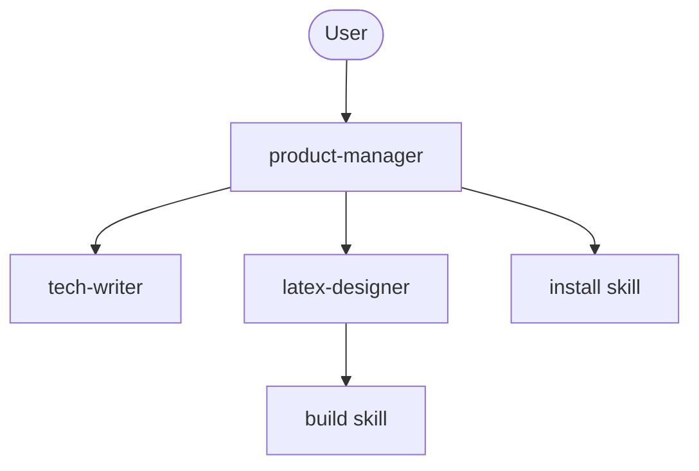

# AI Agents Architecture

This document describes the multi-agent orchestration setup for generating LuaTeX programming presentations.

## Pipeline Overview

`latex-designer` iterates with the `build` skill; `product-manager`
performs the final production validation with the `install` skill.

---

## Team Roster

The authoritative source of access rights is `opencode.json`
(agent permission lists; agent rules are appended after the global
rules and the last matching rule wins).
Note: the `skills:` field in agent frontmatter is decorative in
OpenCode V2 — it does not grant or restrict anything; skill loading
is controlled by the `skill` permission action in `opencode.json` only.

### 1. product-manager (`mode: primary`)
* **Role:** Team orchestrator, supervisor, and user-facing interface.
* **Responsibilities:**
  * Gathers requirements from the user in Russian.
  * Writes prompts and manages task IDs for subagents.
  * Validates the final build via `install` skill.
* **Context Access:** full shell except `git push` / `git reset`
  (`git commit` is allowed, the `install` flow relies on
  `git add` / production build); edits restricted to harness files
  (`.opencode/**`, `opencode.json`, `AGENTS.md`); access to all
  skills (uses `install` and `build` and reads the `luatex-*`
  skills to validate the final PDF against their rules).

### 2. tech-writer (`mode: subagent`)
* **Role:** Subject-matter expert and fact-checker.
* **Responsibilities:**
  * Prepares structured presentation plans based on PM requirements.
  * Writes final slide content and code listings in Russian Markdown.
  * Saves drafts to `drafts/`.
* **Context Access:** `websearch`, `webfetch`, shell except
  `git commit` / `git push` / `git reset` (it may compile example
  code to validate it), edits anywhere except `.opencode/**`,
  `opencode.json`, `AGENTS.md`. No skills at all: every `skill`
  action is denied, which is what keeps it away from the `luatex-*`
  conventions — it must not see or load LaTeX rules.

### 3. latex-designer (`mode: subagent`)
* **Role:** Typesetter and build system engineer.
* **Responsibilities:**
  * Converts Markdown from `tech-writer` into clean LuaTeX code.
  * Manages directory structures, code files in `src/`, and updates `Makefile`.
  * Fixes compilation issues and visual overflows.
* **Context Access:** shell except `git commit` / `git push` /
  `git reset`; edits anywhere except `.opencode/**`,
  `opencode.json`, `AGENTS.md`; access to all skills (loads
  `build`, `luatex-document`, `luatex-presentation`).

---

## Reference Repository

The repository <https://github.com/cppdevcourse/documents> is the
reference for project conventions (beamer layout, 8pt base font size,
listing/terminal package options, footnotes, tables, validation).
Clone it to `/tmp/opencode/` and consult its presentations,
`Packages/`, `Presentations/presentationtemplate.sty` and the
`new-presentation` skill when in doubt.

## Communication & Iteration Rules
1. **Content First:** `tech-writer` must deliver full content before `latex-designer` starts layout.
2. **Layout Overflows:** If content doesn't fit a slide at `\small`, `latex-designer` signals `product-manager` to request a text split from `tech-writer`.
3. **Strict Validation:** `product-manager` only accepts the task after a successful Nix production build check.
